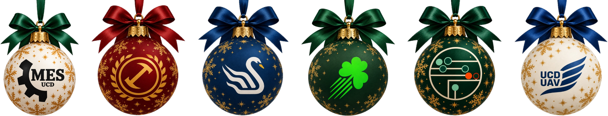
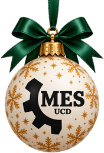
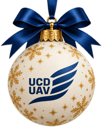
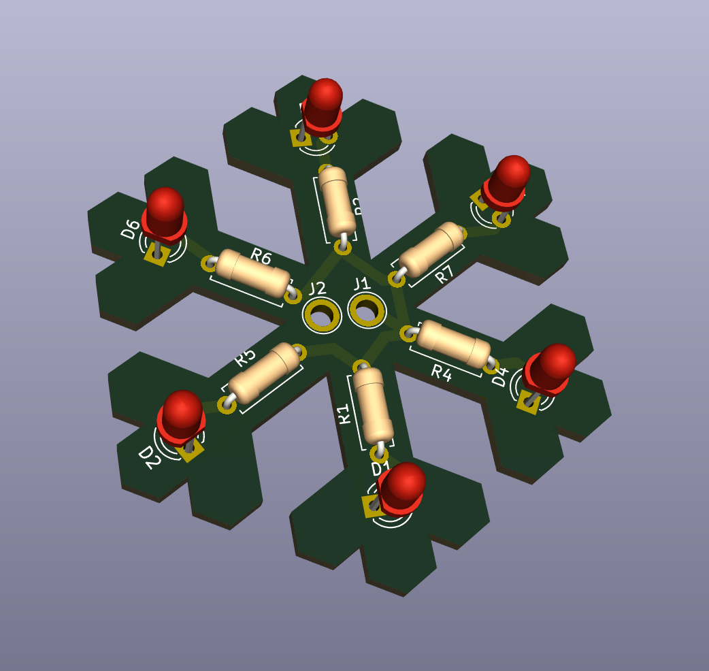
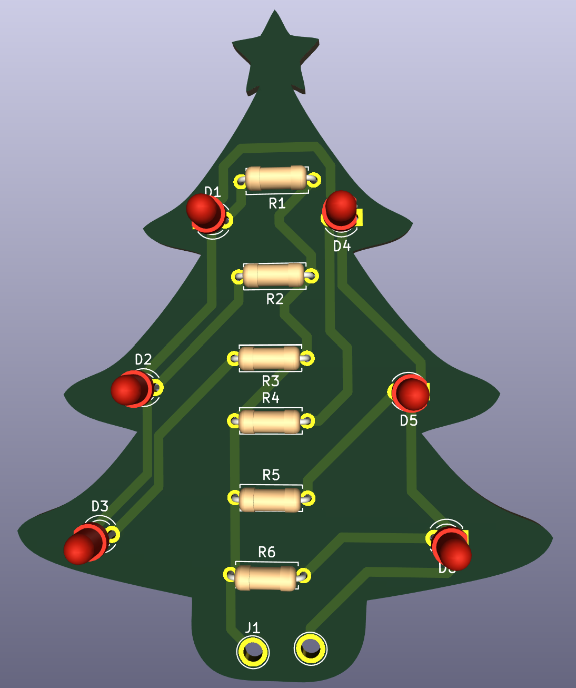

<p align="center">
  
</p>

<h1 align="center">🎄 UCD Engineering & Architecture<br>Christmas Ornament Design Competition 2026 🎄</h1>


Design a Christmas ornament. If you're selected, mentors from across UCD will help you turn it into a real object, and it will be **displayed on the student-made Christmas tree** for the College of Engineering & Architecture.

<p align="center"><b>📅 Submission deadline: 8th November</b></p>


<br clear="all">

---

## ✏️ How to enter



1. Make an **A4 poster** of your ornament design. It must include:
   - Your design (drawing, render or sketch)
   - **Maximum dimensions of 80 mm**
   - Relevant technical details (how it would be made, materials, any electronics)
   - **Your email address**
2. Submit it through the entry form: **TBD**
3. Wait for the shortlist. Selected entrants are contacted by email and invited to this repository to upload their final files.

You don't need any CAD or GitHub experience to enter. The poster is enough.

<br clear="all">

---

## 🎁 What you can win



Selected entrants get to:

- Work with mentors from **GaelForce UCD, UCD UAV, Formula Student, Elec Soc, Mech Soc and Eng Soc**
- Attend workshops in:
  - CAD design
  - 3D printing
  - Soldering
  - PCB design
  - Laser cutting
- Have their ornament built and **displayed on the student-made Christmas tree**

<br clear="all">

---

## 📏 Rules and scope

| | |
|---|---|
| Who can enter | All society and team members |
| Team size | Entries are per person, not teams |
| Max size | Your final ornament must fit inside an 80 mm x 80 mm x 80 mm box |
| Entries per person | You can submit multiple entries |
| Making methods | CAD / 3D printing, laser cutting, PCB design, soldering, and any other creative method |
| Poster format | A4, with design, dimensions, technical details and your email |

---

## 🗓️ Timeline

| Date | What happens |
|---|---|
| **8 November** | Poster submission deadline |
| TBD | Shortlist announced |
| TBD | Workshops |
| TBD | Ornaments added to the tree |

---

## ❄️ Sample ornaments


Look in [`samples/`](samples/) for ornaments we made, with their files and posters, to show what's possible.

| [Snowflake PCB](samples/snowflake/) | [Christmas Tree PCB](samples/christmas-tree/) |
|:---:|:---:|
|  |  |
| A super simple Snowflake PCB by Albin Andrews Joby | A Christmas tree PCB by Elizabeta (Lisaaa!) Berisha |

### 🌍 Community designs

Great ornaments made by others, for inspiration. Click through to see the full design on MakerWorld.

#### 🖨️ 3D printed

| **[Christmas Gnome Couple](https://makerworld.com/en/models/2129753-christmas-gnome-couple-in-ornament-style-with-hear)** | **[Stitch Eating Star Tree Topper](https://makerworld.com/en/models/826178-stitch-eating-star-tree-topper)** | **[Christmas Bauble Decoration](https://makerworld.com/en/models/872702-christmas-bauble-decoration)** |
|:---:|:---:|:---:|
| <a href="https://makerworld.com/en/models/2129753-christmas-gnome-couple-in-ornament-style-with-hear"></a> | <a href="https://makerworld.com/en/models/826178-stitch-eating-star-tree-topper"></a> | <a href="https://makerworld.com/en/models/872702-christmas-bauble-decoration"></a> |
| By [Lumorna](https://makerworld.com/en/@_sTe_) · Detailed print | By [K's Cutesy Creations](https://makerworld.com/en/@kendrac) · Hand painted | By [clamoraes](https://makerworld.com/en/@clamoraes) · 50–60 mm, fits the 80 mm box |
| **[Homer Bushes Ornament](https://makerworld.com/en/models/773052-homer-bushes-ornament-4-color)** | | |
| <a href="https://makerworld.com/en/models/773052-homer-bushes-ornament-4-color"></a> | | |
| By [Printed Solutions](https://makerworld.com/en/@danielnc06) · 4-colour flat print · ~100 mm tall | | |

#### 🔆 Laser cut

| **[3D Wooden Snowflake (Small)](https://makerworld.com/en/models/2012370-3d-wooden-snowflake-small)** | **[Christmas Spiral Tree](https://makerworld.com/en/models/3280994-christmas-spiral-tree-laser-cut-decoration)** | **[Merry Christmas Ornament](https://makerworld.com/en/models/1846898-merry-christmas-ornament)** |
|:---:|:---:|:---:|
| <a href="https://makerworld.com/en/models/2012370-3d-wooden-snowflake-small"></a> | <a href="https://makerworld.com/en/models/3280994-christmas-spiral-tree-laser-cut-decoration"></a> | <a href="https://makerworld.com/en/models/1846898-merry-christmas-ornament"></a> |
| By [Luke](https://makerworld.com/en/@GKLSevenl) · 2 interlocking 3 mm plywood parts · ~50 mm, fits the 80 mm box | By [André Martins](https://makerworld.com/en/@WoodWorksDecor) · Layered MDF or plywood, with snowflake cutouts | By [MagicLaserCrafts](https://makerworld.com/en/@Daniel.B) · Santa ornament |

<br clear="all">

---

## Repository layout

```
README.md        this page
samples/         example ornaments
assets/          images used on this page
```

---

## 💬 Join the community


All announcements (shortlist, workshops, dates and updates) go out in the WhatsApp community, and it's the place to ask questions too. [Join the WhatsApp community](https://chat.whatsapp.com/GV3IXCqxevpB8WDYRLQPnq?s=cl&p=a&mlu=4&ilr=4)

<br clear="all">


---
<p align="center">
  
</p>
