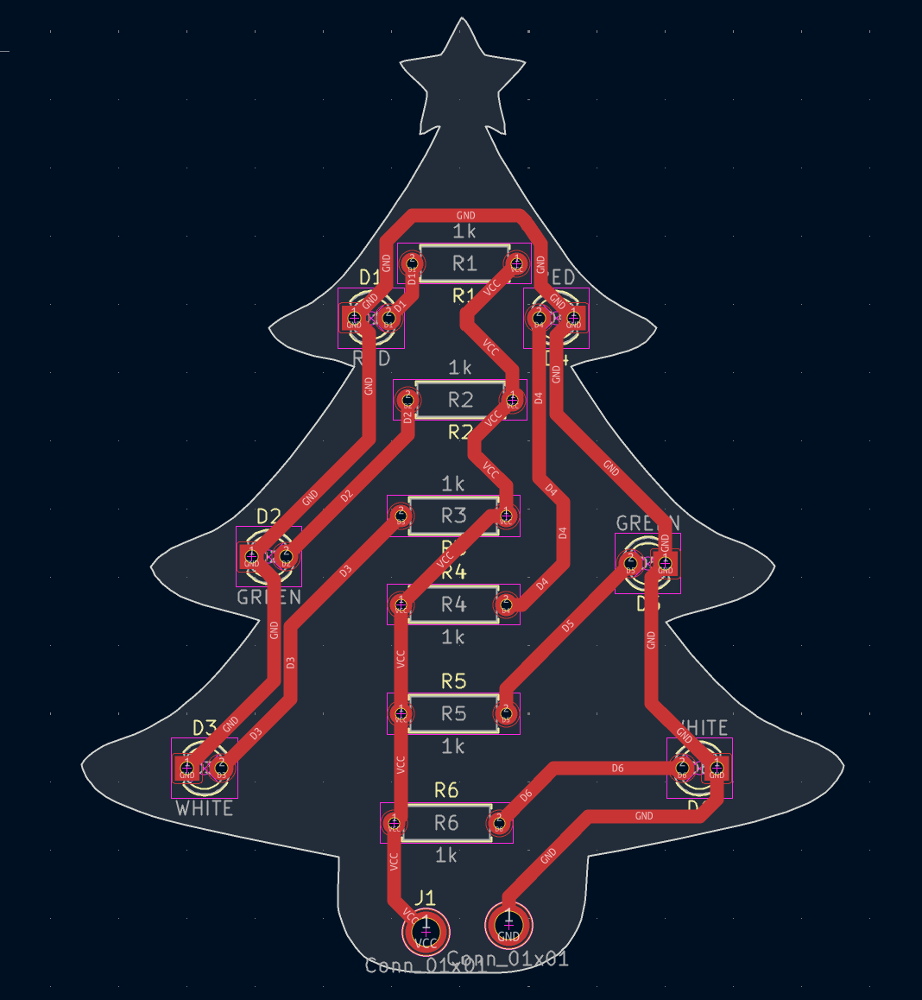

# Christmas Tree

A Christmas tree PCB by **Elizabeta (Lisaaa!) Berisha**, with a star on top and LEDs on the branches.

  

## What's in it

| Part | Qty | Footprint |
|---|---|---|
| LED, 3 mm through-hole (red, green, white) | 6 | `LED_THT:LED_D3.0mm` |
| Resistor, 1 kΩ through-hole | 6 | `Resistor_THT:R_Axial_DIN0207` |
| Plated hole pad (VCC / GND) | 2 | `TestPoint_Plated_Hole_D2.0mm` |

Uses the same footprints as the [Snowflake](../snowflake/). Every LED has its own 1 kΩ resistor.

## Design

### PCB layout

  

## Skills used

- PCB design (KiCad)
- Soldering (all through-hole, good for beginners)
