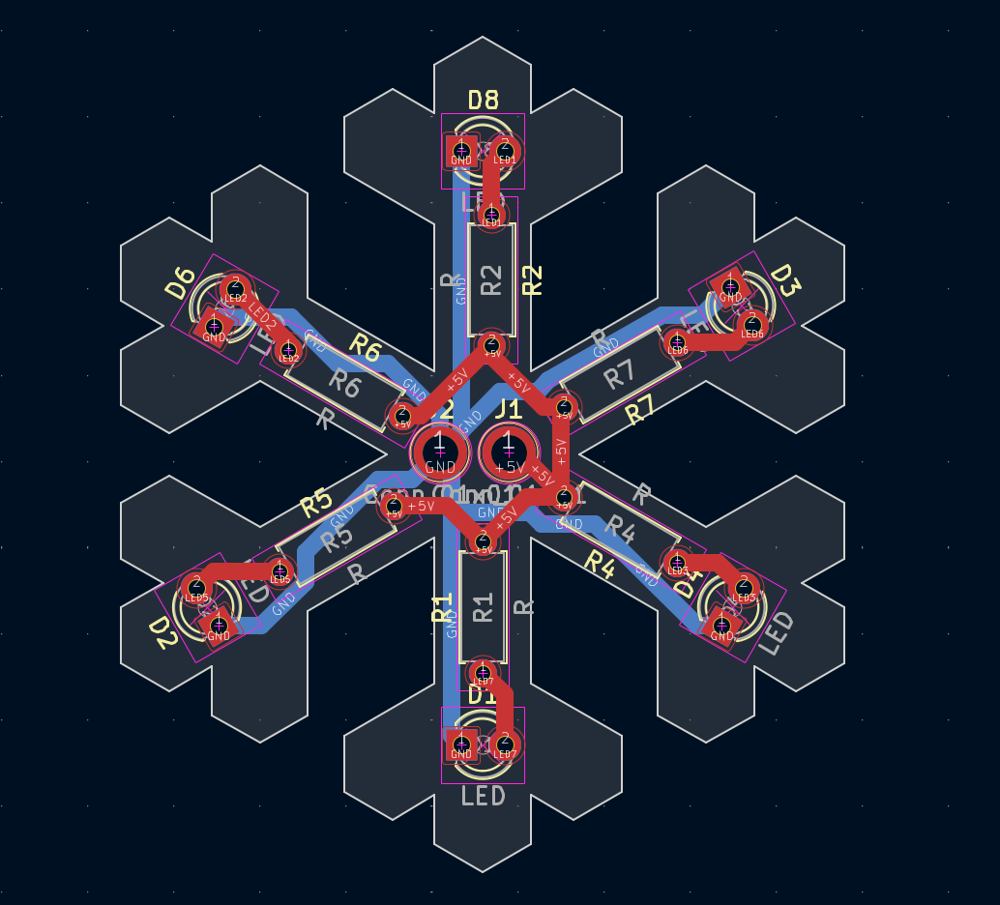
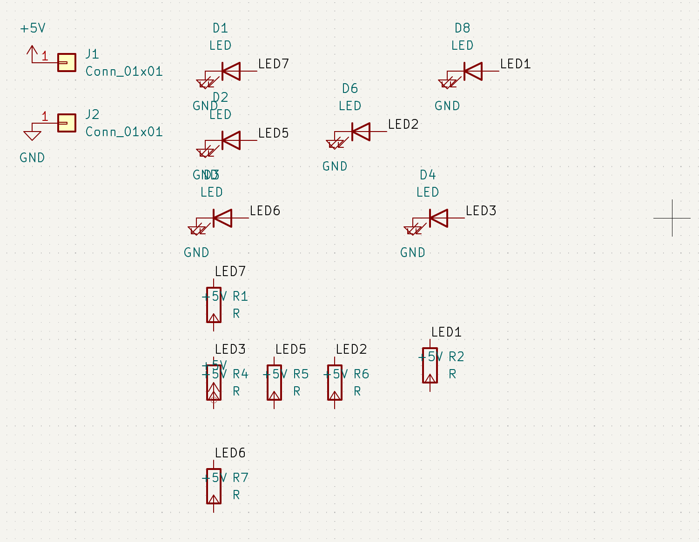

# Snowflake

**Made by Albin Andrews Joby**

A light-up snowflake ornament designed as a PCB in KiCad.

  

## What's in it

| Part | Qty | Footprint |
|---|---|---|
| LED, 3 mm through-hole | 6 | `LED_THT:LED_D3.0mm` |
| Resistor, through-hole | 6 | `Resistor_THT:R_Axial_DIN0207` |
| Plated hole pad (5 V / GND) | 2 | `TestPoint_Plated_Hole_D2.0mm` |

Runs from **5 V**. Every LED has its own resistor.

## Design

### PCB layout

  

### Schematic

  

## Skills used

- PCB design (KiCad)
- Soldering (all through-hole, good for beginners)

## Files

| File | What it is |
|---|---|
| `Snowflake.kicad_pro` | KiCad project |
| `Snowflake.kicad_sch` | Schematic |

Open `Snowflake.kicad_pro` in [KiCad](https://www.kicad.org/) to view the design.
