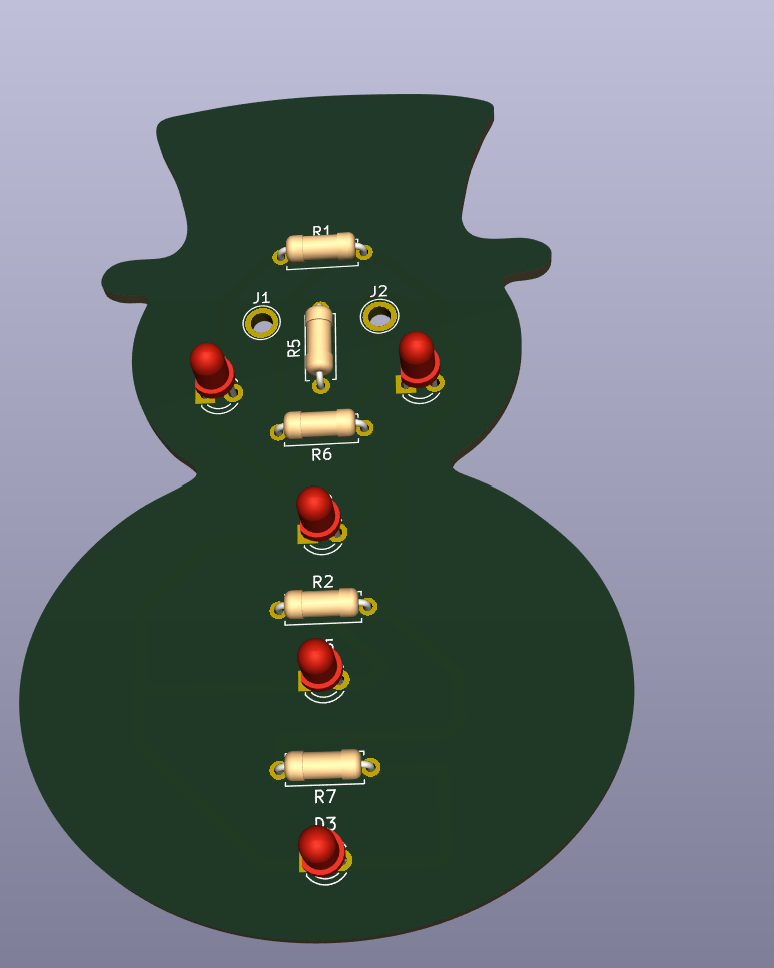
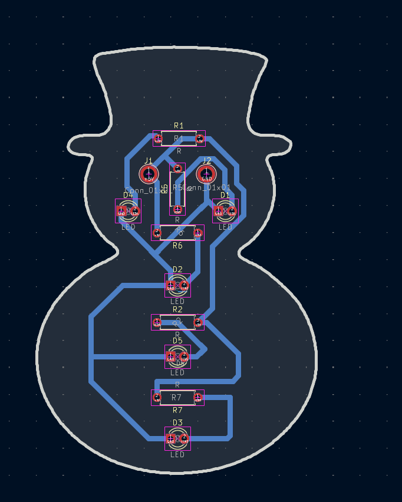
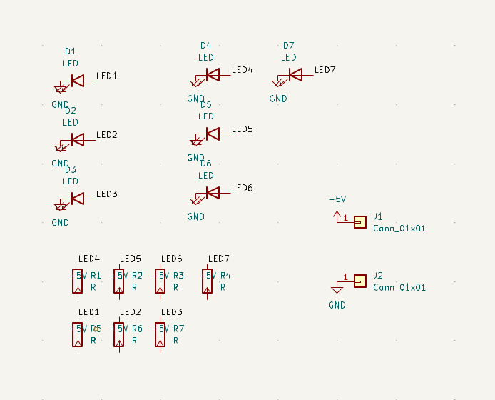

# Snowman

A snowman-shaped PCB by **Anesa Gashi**, with LEDs down its body.

  

## What's in it

| Part | Qty | Footprint |
|---|---|---|
| LED, 3 mm through-hole (`D1`-`D7`) | 7 | `LED_THT:LED_D3.0mm` |
| Resistor, through-hole (`R1`-`R7`) | 7 | `Resistor_THT:R_Axial_DIN0207_L6.3mm_D2.5mm_P7.62mm_Horizontal` |
| Plated hole pad, +5V (`J1`) and GND (`J2`) | 2 | `TestPoint:TestPoint_Plated_Hole_D2.0mm` |

Each LED has its own resistor. The resistor value is not set in the KiCad file, so check the value before ordering parts.

## Design

### PCB layout

  

### Schematic

  

## Skills used

- PCB design (KiCad)
- Soldering (all through-hole, good for beginners)

## Files

| File | What it is |
|---|---|
| `Snowman.kicad_pro` | KiCad project |
| `Snowman.kicad_sch` | Schematic |
| `Snowman.kicad_pcb` | PCB layout |

Open `Snowman.kicad_pro` in [KiCad](https://www.kicad.org/) to view the design.
